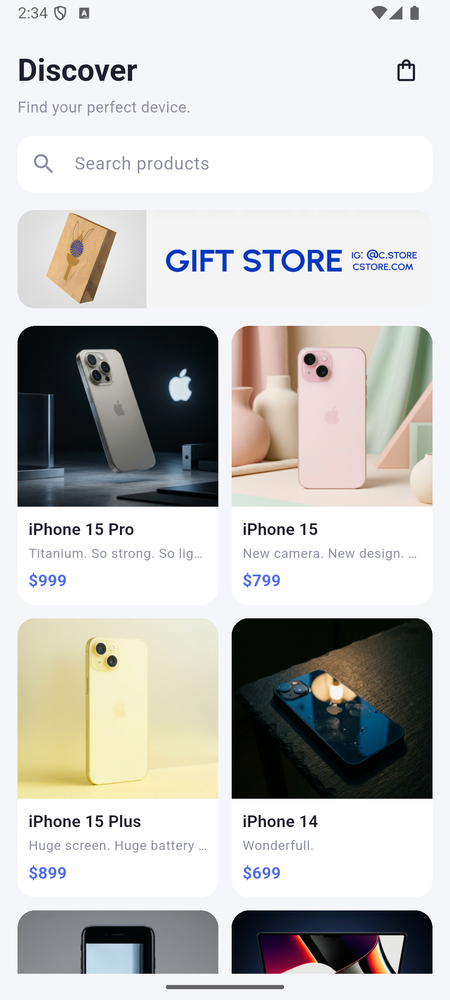
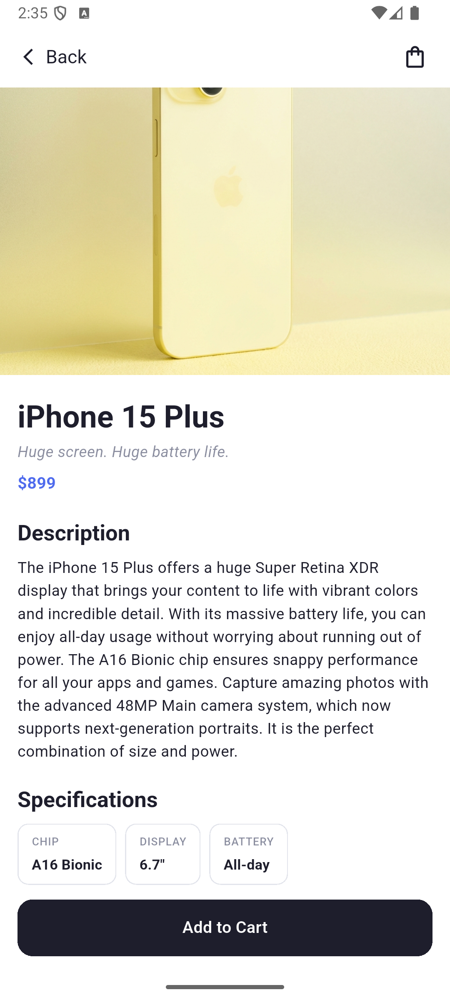
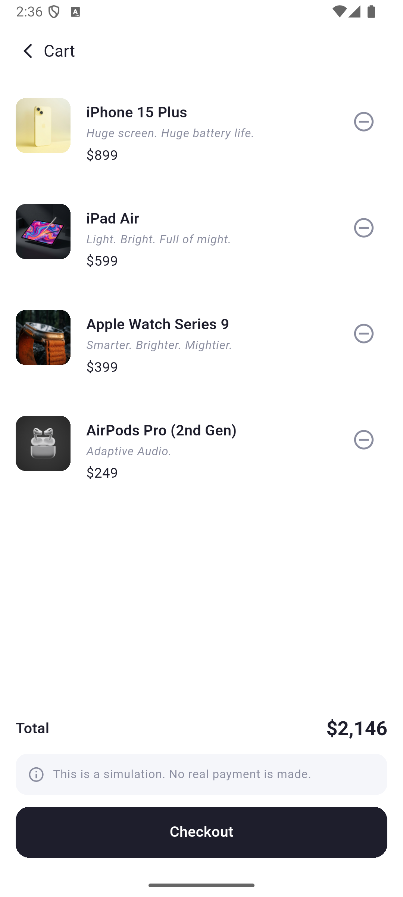
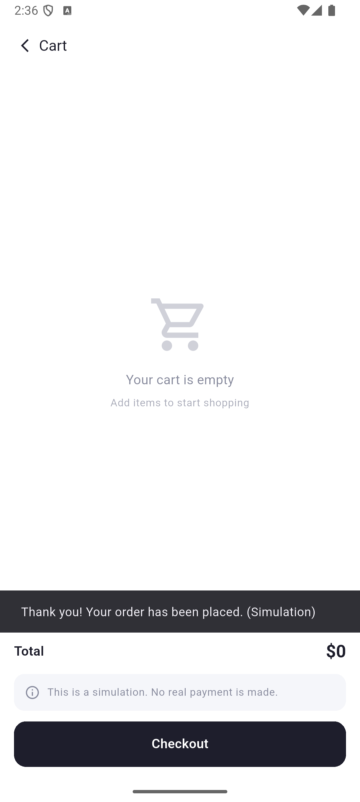

# Mini Katalog Uygulaması

Flutter eğitim haftası kapsamında geliştirilen; ürünleri listeleyen, ürün detayını gösteren ve basit bir sepet simülasyonu içeren mobil katalog uygulaması.

## Özellikler

- Ürün verilerinin yerel JSON dosyasından okunması (`rootBundle` ile JSON simülasyonu)
- Ürünlerin 2 sütunlu `GridView` ile kart tabanlı listelenmesi
- Ürün adına göre arama / filtreleme (`setState`)
- Named Routes ve Route Arguments ile ürün detay sayfasına geçiş
- Ürün detayında açıklama ve teknik özellikler (Specifications)
- Sepete ekleme / çıkarma, toplam tutar, boş sepet ekranı ve Checkout simülasyonu
- Sepet durumunun `ChangeNotifier` ile yönetimi
- Ekstra paket kullanılmadan, yalnızca Flutter SDK (`material.dart`) ile geliştirilmiştir

## Kullanılan Teknolojiler

| Araç | Sürüm |
|---|---|
| Flutter | 3.47.7 (stable) |
| Dart | 3.13.5 |
| Hedef platform | Android (Emulator: Medium Phone API 35) |
| Editör | Visual Studio Code |
| Emülatör aracı | Android Studio (yalnızca Android Emulator için) |

> Sürüm bilgisi `flutter --version` komutunun çıktısından alınmıştır.

## Proje Yapısı

```
lib/
├── main.dart
├── app/        # rotalar ve tema
├── models/     # Product modeli (fromJson / toJson)
├── data/       # JSON veri okuma (repository)
├── state/      # sepet durumu (ChangeNotifier)
├── screens/    # home, detail, cart ekranları
├── widgets/    # tekrar kullanılan bileşenler
└── utils/      # yardımcı fonksiyonlar (fiyat çevirme)
assets/
├── data/       # products.json
└── images/     # banner görseli
screenshots/    # README ekran görüntüleri
```

## Çalıştırma Adımları

1. Flutter SDK'nın kurulu olduğundan emin olun:
   ```bash
   flutter doctor
   ```
2. Repoyu klonlayın:
   ```bash
   git clone https://github.com/meileyy/mini_katalog.git
   cd mini_katalog
   ```
3. Bağımlılıkları yükleyin:
   ```bash
   flutter pub get
   ```
4. Bir Android emülatörü başlatın veya cihaz bağlayın, ardından çalıştırın:
   ```bash
   flutter run
   ```

> Ürün görselleri internetten yüklendiği için cihazın/emülatörün internet bağlantısı olmalıdır.

## Ekran Görüntüleri

| Ana Sayfa | Ürün Detayı | Sepet | Boş Sepet |
|---|---|---|---|
|  |  |  |  |

## Veri Kaynağı

Ürün verileri [wantapi.com](https://wantapi.com/products.php) adresindeki eğitim amaçlı mock veriden alınmış ve `assets/data/products.json` olarak projeye eklenmiştir. Bu veri gerçek bir e-ticaret altyapısını temsil etmez. Ürün adları ve markalar ilgili sahiplerine aittir; veri yalnızca eğitim amaçlı kullanılmıştır.
