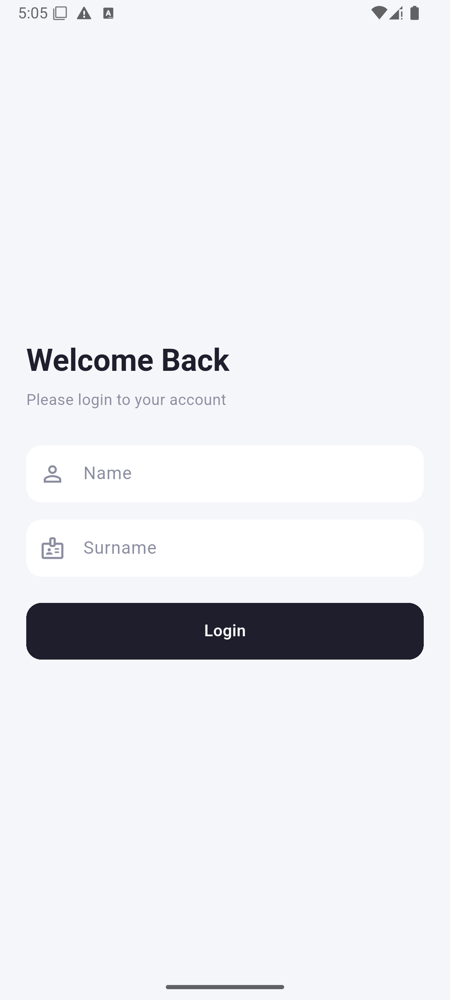

# Mini Katalog Uygulaması

Flutter eğitim haftası kapsamında geliştirilen; ad/soyad ile giriş yapılan, ürünleri API'den çekip listeleyen, ürün detayını gösteren ve basit bir sepet simülasyonu içeren mobil katalog uygulaması.

## Özellikler

- Ad/soyad ile login; bilgiler `shared_preferences` ile cihazda saklanır, sonraki açılışta login atlanır
- Ana sayfada *"Welcome, <Ad>"* selamlaması ve logout (kayıt silinir, sepet boşaltılır, login ekranına dönülür)
- Ürünlerin `http` paketiyle API'den çekilmesi (`wantapi.com`, 10 sn zaman aşımı)
- API'ye ulaşılamazsa yerel JSON dosyasına düşülmesi (`rootBundle` ile JSON simülasyonu)
- Ürünlerin 2 sütunlu `GridView` ile kart tabanlı listelenmesi
- Ürün adına göre arama / filtreleme (`setState`, Türkçe karakter uyumlu)
- Named Routes ve Route Arguments ile ürün detay sayfasına geçiş
- Ürün detayında açıklama ve teknik özellikler (Specifications)
- Sepete ekleme / çıkarma, toplam tutar, boş sepet ekranı ve Checkout simülasyonu
- Sepet durumunun `ChangeNotifier` ile yönetimi
- Flutter SDK (`material.dart`) dışında yalnızca hocanın derste gösterdiği paketler kullanılmıştır.

## Kullanılan Paketler


| Paket | Kullanım amacı |
|---|---|
| [`http`](https://pub.dev/packages/http) | Ürünleri `https://wantapi.com/products.php` adresinden çekmek |
| [`shared_preferences`](https://pub.dev/packages/shared_preferences) | Login: kullanıcı adı/soyadını cihazda saklamak |

Testlerde gerçek internete çıkılmaz; `http` paketinin kendi `MockClient`'ı (`package:http/testing.dart`) kullanılır.
Yerel saklama testlerinde `shared_preferences` paketinin kendi `SharedPreferences.setMockInitialValues` metodu kullanılır.

## Kullanılan Teknolojiler

| Araç | Sürüm |
|---|---|
| Flutter | 3.47.7 (stable) |
| Dart | 3.13.5 |
| Hedef platform | Android (Emulator: Medium Phone API 35) |
| Editör | Visual Studio Code |
| Emülatör aracı | Android Studio (yalnızca Android Emulator için) |

`flutter --version` çıktısı:

```
Flutter 3.47.7 • channel stable • https://github.com/flutter/flutter.git
Framework • revision abaf9c5237 (10 days ago) • 2026-10-08 09:51:21 -0700
Engine • hash d8a2d6c768c334d53e16277f837970ffa1e2de81 (revision deb287481e) (10 days ago) • 2026-10-07 17:09:12.000Z
Tools • Dart 3.13.5 • DevTools 2.60.0
```

## Proje Yapısı

```
lib/
├── main.dart                         # uygulamanın girişi: kayıtlı kullanıcıya göre login veya ana sayfa açılır
├── app/
│   ├── routes.dart                   # rota adları (login, home, detail, cart) ve onGenerateRoute
│   └── theme.dart                    # renkler (AppColors) ve tema (AppTheme)
├── components/                       # tekrar kullanılan bileşenler:
│                                     # product_card_tile, mini_card_tile, empty_cart, search_bar_field, spec_chip,
│                                     # product_image, back_label_button, cart_icon_button, add_to_cart_button,
│                                     # cart_summary, checkout_button
├── models/
│   └── products_model.dart           # Product modeli (fromJson / toJson)
├── services/
│   ├── api_service.dart              # http ile API'den ürün çekme; hata olursa yerel JSON'a düşer
│   └── local_storage_service.dart    # shared_preferences ile kullanıcı ad/soyadını kaydetme, okuma, silme
├── state/
│   └── cart_controller.dart          # sepet durumu (ChangeNotifier) + global cartController
├── utils/
│   ├── price_parser.dart             # "$2,499" → 2499.0
│   ├── price_formatter.dart          # 3498.0 → "$3,498"
│   └── search_text.dart              # aramada Türkçe karakter uyumu
└── views/
    ├── login_screen.dart
    ├── home_screen.dart
    ├── product_detail_screen.dart
    └── cart_screen.dart
assets/
├── data/products.json                # API'ye ulaşılamazsa kullanılan yedek veri
└── images/banner.png                 # ana sayfa banner görseli
screenshots/                          # README ekran görüntüleri
test/                                 # birim ve widget testleri
```

## Çalıştırma Adımları

1. Flutter SDK'nın kurulu olduğundan emin olun:
   ```bash
   flutter doctor
   ```
2. Repoyu klonlayın:
   ```bash
   git clone https://github.com/meileyy/mini_katalog.git
   cd mini_katalog
   ```
3. Bağımlılıkları yükleyin:
   ```bash
   flutter pub get
   ```
4. Bir Android emülatörü başlatın veya cihaz bağlayın, ardından çalıştırın:
   ```bash
   flutter run
   ```

> Ürünler ve görselleri internetten yüklendiği için cihazın/emülatörün internet bağlantısı olmalıdır.
> İnternet yoksa ürün listesi yerel JSON'dan gelir; görseller yerine gri yer tutucu görünür.

## Testler

```bash
flutter analyze   # statik analiz
flutter test      # tüm testler
```

Testler internet bağlantısı gerektirmez. Kapsam:

- **Model ve yardımcılar:** `Product.fromJson` / `toJson`, eksik veya yanlış tipte alanlar, fiyat çevirme ve biçimlendirme, Türkçe karakterli arama
- **API servisi:** başarılı yanıt; 500 hatası, bağlantı hatası, zaman aşımı, bozuk veya boş JSON durumlarında yerel JSON'a düşme (`MockClient`)
- **Yerel saklama:** ad/soyad kaydetme, okuma, silme (`SharedPreferences.setMockInitialValues`)
- **Sepet:** ekleme, çıkarma, temizleme, toplam tutar, `notifyListeners`
- **Ekranlar:** login doğrulaması ve yönlendirme, arama filtresi, sepet rozeti, logout, detay ekranı, sepet ve Checkout

## Ekran Görüntüleri

| Login | Ana Sayfa | Ürün Detayı |
|---|---|---|
|  |  |  |

| Sepet | Boş Sepet |
|---|---|
|  |  |

## Veri Kaynağı

Ürün verileri uygulama açılışında [wantapi.com](https://wantapi.com/products.php) adresindeki eğitim amaçlı mock API'den `http` ile çekilir. Aynı verinin bir kopyası `assets/data/products.json` olarak projede bulunur; istek başarısız olursa (zaman aşımı, bağlantı hatası, 200 dışı yanıt, bozuk veya boş veri) bu yedek kullanılır. Bu veri gerçek bir e-ticaret altyapısını temsil etmez.

> **Not:** Ürün adları ve markalar sahiplerine aittir; veri yalnızca eğitim amaçlıdır.
